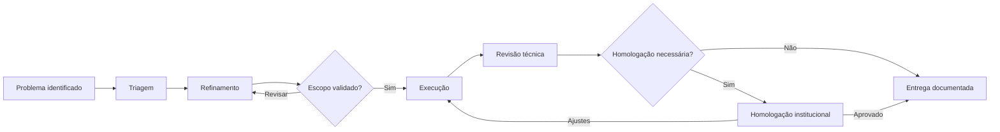

# Governança colaborativa do PPGMCS

Espaço de documentação e discussão da iniciativa voluntária de reorganização dos portais, conteúdos, documentos, processos e instrumentos de autoavaliação do PPGMCS/Unimontes.

> **Status: proposta em construção.** Nada neste repositório deve ser interpretado como ato, política ou decisão oficial do programa sem validação explícita da instância competente.

## Documentação

- [Governança e responsabilidades](docs/governanca.md)
- [Frentes de trabalho](docs/frentes-de-trabalho.md)
- [Fluxo de demandas](docs/fluxos/demandas.md)
- [Fluxo de homologação](docs/fluxos/aprovacao.md)
- [Levantamento inicial](docs/levantamento.md)
- [Registro de decisões](docs/decisoes/README.md)
- [Como contribuir](CONTRIBUTING.md)

## Visão do processo

## Princípios propostos

- Descrever problemas antes de selecionar tecnologias.
- Estudantes lideram levantamento, refinamento, documentação, implementação e revisão técnica.
- Docentes e órgãos competentes validam conteúdo, prioridades e decisões institucionais.
- Distinguir revisão técnica de homologação e autorização de publicação.
- Registrar decisões e justificativas para manter continuidade mesmo com rotatividade de voluntários.
- Considerar acessibilidade, proteção de dados e manutenção desde o planejamento.

**Origem:** levantamento inicial a partir de conversa do grupo em 18–21/11/2026. Sugestões complementares estão identificadas como propostas.
