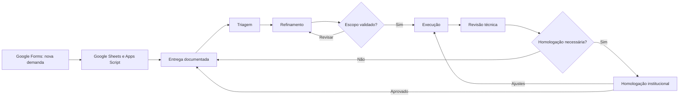

# Governança colaborativa do PPGMCS

Espaço de documentação e discussão da iniciativa voluntária de reorganização dos portais, conteúdos, documentos, processos e instrumentos de autoavaliação do PPGMCS/Unimontes.

> **Status: proposta em construção.** Nada neste repositório deve ser interpretado como ato, política ou decisão oficial do programa sem validação explícita da instância competente.

## Registrar uma demanda

**Canal de entrada adotado para a operação:** [Formulário de demandas do PPGMCS](https://docs.google.com/forms/d/e/1FAIpQLScMfcz1FtOyBGHIW5whgcdp14P3vui7PoHPUHSfkJieHMIk-g/viewform).

Respostas são registradas no Google Sheets e processadas pelo Google Apps Script, que cria uma Issue pública no GitHub para triagem. **Não informe dados pessoais, credenciais ou informações sigilosas nos campos de descrição**, pois poderão ser publicados. [Veja o fluxo de entrada e as regras de privacidade](docs/fluxos/entrada-formulario.md).

A criação manual de Issues deixa de ser o procedimento padrão para novas demandas. Ela fica reservada à manutenção técnica do projeto, correções internas e contingências administradas pelos responsáveis.

## Protótipo do novo portal

- [Protótipo navegável (HTML)](prototypes/portal/index.html)
- [Instruções e limitações do protótipo](prototypes/portal/README.md)

O protótipo demonstra a central de ajuda/FAQ e a agenda acadêmica com eventos fictícios, **sem formulário de demandas**. **Ainda não é uma versão homologada do portal.**

**Publicação isolada:** [workflow de GitHub Pages](.github/workflows/deploy-portal.yml). Após ativar **Settings → Pages → GitHub Actions**, o site deverá ser acessível em [maiandreh.github.io/ppgmcs-governance](https://maiandreh.github.io/ppgmcs-governance/).

## Documentação

- [Governança e responsabilidades](docs/governanca.md)
- [Frentes de trabalho](docs/frentes-de-trabalho.md)
- [Entrada de demandas pelo formulário](docs/fluxos/entrada-formulario.md)
- [Fluxo de demandas](docs/fluxos/demandas.md)
- [Fluxo de homologação](docs/fluxos/aprovacao.md)
- [Levantamento inicial](docs/levantamento.md)
- [Requisitos: agenda acadêmica, eventos e bancas](docs/requisitos-portal-agenda.md)
- [Requisitos: central de ajuda e FAQ](docs/requisitos-portal-faq.md)
- [Registro de decisões](docs/decisoes/README.md)
- [Como contribuir](CONTRIBUTING.md)
- [Integração Google Forms → GitHub Issues](integrations/google-forms/README.md)

## Visão do processo

## Princípios propostos

- Descrever problemas antes de selecionar tecnologias.
- Estudantes lideram levantamento, refinamento, documentação, implementação e revisão técnica.
- Docentes e órgãos competentes validam conteúdo, prioridades e decisões institucionais.
- Distinguir revisão técnica de homologação e autorização de publicação.
- Registrar decisões e justificativas para manter continuidade mesmo com rotatividade de voluntários.
- Considerar acessibilidade, proteção de dados e manutenção desde o planejamento.

**Origem:** levantamento inicial a partir de conversa do grupo em 18–21/11/2026. Sugestões complementares estão identificadas como propostas.
