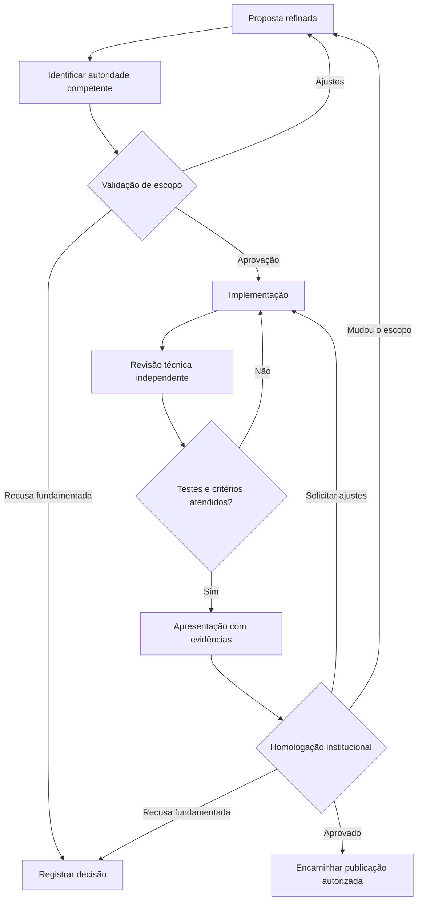

# Aprovação e homologação

**Status: proposta — não homologada.**

## Evidências mínimas para decisão

- Issue e PR ou versão avaliada;
- resultado esperado e critérios de aceite;
- evidências de revisão/testes;
- aprovador e sua competência;
- data, resultado e justificativa;
- providência em caso de ajustes ou recusa.

**Importante:** a aprovação de código no GitHub não autoriza automaticamente a implantação em sistemas ou domínios da Unimontes.
