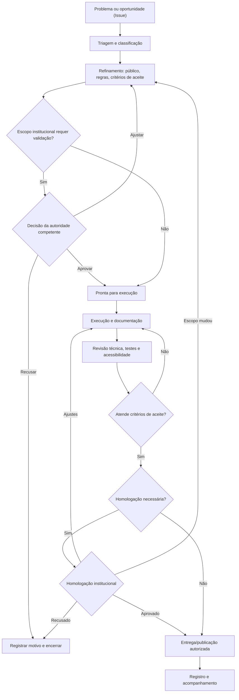

# Fluxo de demandas

**Status: proposta — ainda não aprovada.**

## Estados sugeridos no GitHub Projects

Proposta → Triagem → Refinamento → Aguardando validação → Pronta → Em execução → Em revisão → Em homologação → Concluída.

Demandas bloqueadas ou recusadas devem ter motivo rastreável. Nem toda correção técnica exige uma nova homologação acadêmica. Já alterações de processo, regra ou conteúdo oficial precisam de autoridade identificada.
