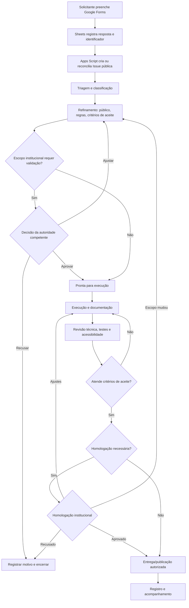

# Fluxo de demandas

**Entrada operacional:** [Google Forms](https://docs.google.com/forms/d/e/1FAIpQLScMfcz1FtOyBGHIW5whgcdp14P3vui7PoHPUHSfkJieHMIk-g/viewform). As etapas de governança e aprovação abaixo continuam propostas para deliberação.

A entrada de uma demanda ocorre **pelo formulário**, não pela abertura manual de Issue. Problemas internos de infraestrutura podem ser registrados diretamente pelos mantenedores. Consulte [fluxo detalhado de entrada](entrada-formulario.md).

## Estados sugeridos no GitHub Projects

Proposta → Triagem → Refinamento → Aguardando validação → Pronta → Em execução → Em revisão → Em homologação → Concluída.

Demandas bloqueadas ou recusadas devem ter motivo rastreável. Nem toda correção técnica exige uma nova homologação acadêmica. Já alterações de processo, regra ou conteúdo oficial precisam de autoridade identificada.
