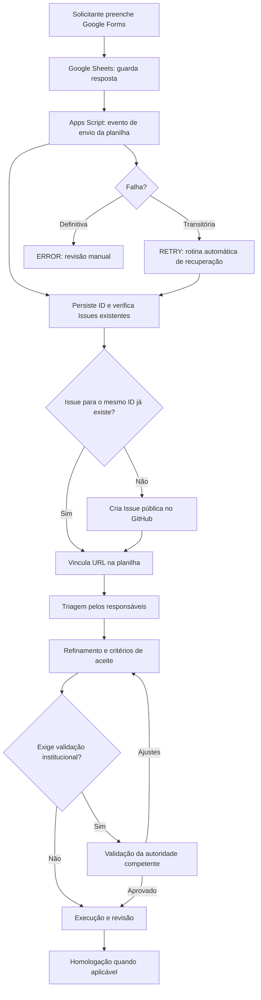

# Entrada de demandas pelo Google Forms

**Situação:** fluxo de entrada já configurado e testado pelo responsável. As etapas de triagem, refinamento e governança seguem sujeitas à deliberação do grupo.

## Canal oficial de entrada do projeto

**[Registrar nova demanda — Google Forms](https://docs.google.com/forms/d/e/1FAIpQLScMfcz1FtOyBGHIW5whgcdp14P3vui7PoHPUHSfkJieHMIk-g/viewform)**

O formulário **substitui a abertura manual de Issues como procedimento padrão** para estudantes, docentes, egressos, técnicos e outros colaboradores. Não é necessário ter uma conta no GitHub para registrar uma demanda.

O repositório de destino é [maiandreh/ppgmcs-governance](https://github.com/maiandreh/ppgmcs-governance); suas [Issues são públicas](https://github.com/maiandreh/ppgmcs-governance/issues).

## Diagrama de entrada e tratamento

## Divisão de responsabilidades

| Ator | Atribuição |
| --- | --- |
| Solicitante | Descrever problema sem incluir dados pessoais nos campos publicados |
| Formulário/planilha | Receber a submissão e manter registro de integração |
| Apps Script | Gerar ID, checar duplicidade por submissão, criar ou localizar Issue e registrar resultado |
| Equipe de triagem | Classificar, investigar duplicidades temáticas e solicitar esclarecimentos |
| Estudantes das frentes | Refinar, desenvolver, documentar e revisar tecnicamente |
| Docentes/instâncias competentes | Validar regras, conteúdo, escopo e homologação conforme atribuição |

## Campos e visibilidade

A integração técnica atualmente publica os valores dos campos de **título, categoria, descrição do problema, público afetado, sugestão e referência**. Os campos que eventualmente sejam acrescentados à planilha não são publicados automaticamente, a menos que o código seja modificado para isso.

| Dado | Local apropriado | Condição |
| --- | --- | --- |
| Nome do solicitante | Google Sheets restrito | Proposta de coleta; confirmar que o Form já inclui o campo |
| E-mail de contato | Google Sheets restrito | Proposta de coleta; confirmar coleta e base de tratamento |
| Vínculo institucional | Google Sheets; opcionalmente categoria pública | Confirmar configuração e pertinência antes de publicar |
| Título, problema, sugestão | GitHub Issues público | O solicitante não deve mencionar pessoas ou dados protegidos |
| Identificador de submissão e URL da Issue | Planilha; identificador técnico também na Issue | Usados para rastreabilidade e idempotência |

**Atenção:** o código atual **não anonimiza nem remove automaticamente dados pessoais inseridos em campos de texto livre**. Com publicação imediata, um solicitante pode divulgar informações indevidas. Não considere a política de privacidade plenamente implementada sem novos controles e teste.

### Antes de ampliar o acesso

1. Confirmar se o formulário atual coleta nome, e-mail e vínculo; não presumir que as mudanças sugeridas anteriormente tenham sido aplicadas.
2. Identificar responsável pelo tratamento, finalidade e acesso à planilha; definir política de retenção e atendimento a solicitações de correção/exclusão, conforme avaliação institucional e LGPD.
3. Informar que o conteúdo descritivo será publicado publicamente e não solicitar dados desnecessários.
4. Restringir a planilha e o Apps Script à equipe autorizada; não publicar links de edição, token ou credenciais.
5. Avaliar um mecanismo de revisão pré-publicação para conter dados pessoais, conteúdo ofensivo ou spam. Isso **não faz parte da versão automática atual**.

## Regras de duplicidade

- Cada linha da planilha recebe um UUID persistido.
- O script verifica se uma Issue com essa marca já existe, inclusive fechada.
- A execução usa bloqueio para impedir duplicação simultânea no mesmo projeto.
- Falhas transitórias são reprocessadas e erros permanentes exigem intervenção.
- **Limite:** textos semelhantes enviados como respostas diferentes têm UUIDs diferentes e podem gerar Issues diferentes; a equipe fará deduplicação temática durante a triagem.

## Procedimento de exceção

Criação direta de Issue por pessoas com permissão no GitHub fica restrita a manutenção do projeto, tarefas técnicas internas, subtarefas ou contingências. Quando uma demanda de usuário entrar por exceção, registrar sua origem e evitar expor contatos.

## Operação e mudança de código

- [Implementação e instalação](../../integrations/google-forms/README.md)
- [Script de integração](../../integrations/google-forms/Code.gs)
- [Fluxo de refinamento e homologação](demandas.md)
- [Guia de contribuição](../../CONTRIBUTING.md)

**Importante:** os arquivos `.gs` neste GitHub são a fonte versionada, mas não há sincronização automática com o editor Apps Script. Mudanças futuras deverão ser implantadas no projeto Google que já opera o formulário, e testadas por uma submissão controlada. Não recriar o formulário existente.
