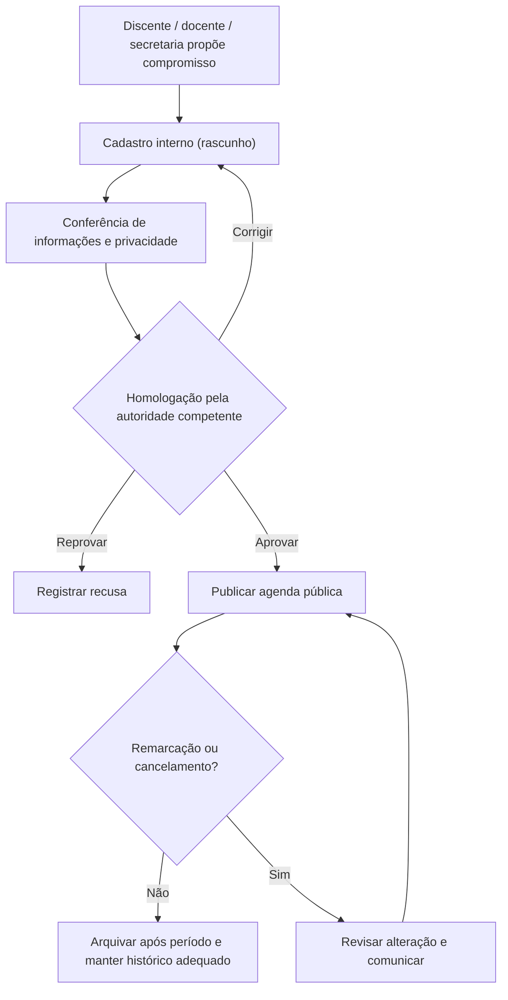

# Requisitos do portal — agenda, bancas e calendário acadêmico

**Status:** proposta funcional para refinamento com docentes, discentes e secretaria. Não representa decisão institucional homologada.

## Objetivo

Oferecer uma **agenda pública integrada** de eventos, próximas bancas e marcos acadêmicos, distinguindo claramente informações confirmadas de rascunhos ou solicitações em análise. A agenda deve poder ser consultada por mês, por tipo e por período, inclusive em dispositivos móveis.

## Escopo público proposto

- **Próximas bancas:** qualificações e defesas, com data, hora, título autorizado, discente, orientação, membros quando autorizados, modalidade, local ou acesso público e situação (confirmada, remarcada, cancelada).
- **Eventos:** seminários, palestras, jornadas, conferências, atividades de extensão e eventos de grupos de pesquisa.
- **Calendário acadêmico:** matrícula/rematrícula, oferta de disciplinas, períodos de inscrição, prazos acadêmicos e outros marcos confirmados pela instituição.
- **Atividades:** reuniões e atividades coletivas destinadas ao público do portal, sem expor eventos restritos ou detalhes internos.
- **Busca e filtros:** mês, data, tipo, modalidade, palavra-chave e exibição de próximos compromissos.
- **Acesso simplificado:** calendário mensal, lista cronológica, link permanente por evento, arquivo iCalendar (.ics), e eventualmente feed público, sujeito à aprovação.
- **Atualizações:** registrar remarcação/cancelamento, data da última atualização e fonte responsável; evitar manter links obsoletos em cache.

## Campos recomendados para um registro de agenda

| Campo | Tipo | Obrigatoriedade |
| --- | --- | --- |
| Identificador | UUID/slug | Sim |
| Tipo | banca, evento, prazo, atividade | Sim |
| Título | texto | Sim |
| Descrição pública | texto revisado | Sim |
| Início e fim | data/hora com fuso | Sim para eventos; prazos podem ter apenas data |
| Fuso | IANA, preferencialmente America/Sao_Paulo | Sim |
| Modalidade | presencial, remoto, híbrido | Quando aplicável |
| Local / link público | endereço ou URL previamente aprovada | Quando aplicável |
| Participantes autorizados | nomes e papéis | Quando aplicável e autorizado |
| Fonte | documento/canal institucional | Sim |
| Responsável pela publicação | perfil autenticado | Sim (metadado interno) |
| Estado | rascunho, aguardando aprovação, publicado, remarcado, cancelado, arquivado | Sim |
| Alteração e justificativa | histórico auditável | Para mudanças |

## Fluxo de cadastro e aprovação

**Importante:** o fluxo de demanda do Google Forms → GitHub Issues **não é** o calendário institucional e não autoriza publicar bancas. Um eventual formulário de solicitação de banca deve ser separado do cadastro de evento confirmado.

## Requisitos não funcionais e pontos de atenção

1. **Fonte da verdade:** definir secretaria, coordenação ou sistema acadêmico oficial como origem de cada tipo de registro. Evitar datas duplicadas e divergentes.
2. **Responsabilidades:** designar quem cadastra, quem homologa, quem corrige e quem retira publicações desatualizadas.
3. **Privacidade:** não revelar dados pessoais, informações de avaliação, links privados de reunião, documentos internos ou dados de candidatos sem base apropriada e avaliação institucional.
4. **Acessibilidade:** além da grade visual, oferecer lista cronológica navegável por teclado e leitores de tela; sinalizar tipos por texto, não apenas cor.
5. **Prazos:** distinguir prazo oficial, evento e sugestão; exibir data de revisão e link para edital/norma.
6. **Fusos e horário de verão:** armazenar data/hora com fuso explícito e tratar corretamente exportação `.ics` para consumidores.
7. **Integridade:** impedir que evento em rascunho seja exposto; manter registro de edições, permissões por papel e backup.
8. **Comunicação:** definir como remarcações serão refletidas em agendas já exportadas/assinadas (arquivos individuais não atualizam automaticamente).
9. **Governança de conteúdo:** decidir retenção de eventos passados, arquivamento e política de comunicação de cancelamentos.
10. **Integração futura:** avaliar iCalendar e API/sistema institucional autorizado antes de vincular a provedores externos. Não pressupor integração com Google Calendar.

## Escopo do protótipo HTML

A versão demonstrativa inclui visualização mensal, navegação, filtro de tipos, detalhes resumidos, listagem acessível e download de exemplo `.ics`. Usa **eventos fictícios** fixos e não possui banco de dados, autenticação, editor administrativo, workflow real de homologação, feeds sincronizados ou informações oficiais.

**Próxima validação:** confirmar com docentes e secretaria quais dados das bancas podem ser divulgados, em qual momento, por qual responsável e com qual fonte oficial.
