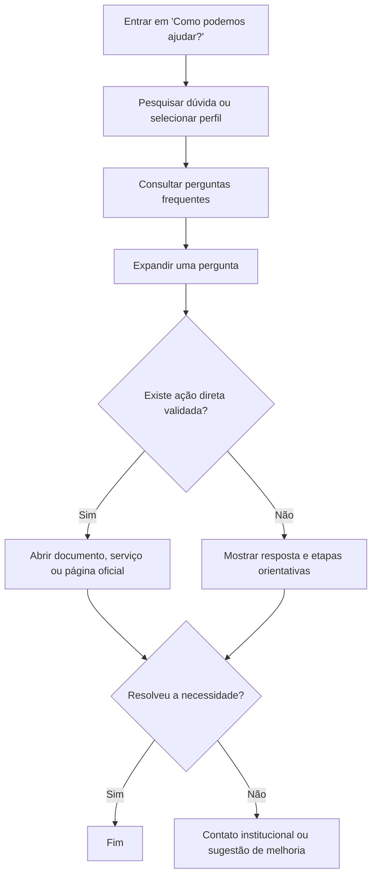

# Central de ajuda e perguntas frequentes (FAQ)

**Status:** requisito e protótipo para validação pelo grupo e instâncias competentes.

## Decisão de arquitetura proposta

A seção **"Como podemos ajudar?" deve ser independente** da apresentação institucional e organizada como uma **central de perguntas frequentes**. Não será apenas uma listagem de cartões de serviços.

A central deve permitir **dois caminhos complementares**:

1. **Resposta informativa:** pergunta e resposta expansível, com etapas e explicação. Não depende da existência de um serviço digital.
2. **Resposta com ação direta:** pergunta e resposta expansível, acrescida de um botão/link para documento oficial, agenda, edital, formulário ou sistema existente e validado.

**Não criar atalhos falsos** para procedimentos que ainda não estejam disponíveis. Quando não houver ação digital homologada, oferecer orientação sobre o procedimento e o canal institucional competente.

## Fluxo do visitante (Mermaid)



## Estrutura recomendada

- Busca por palavras-chave nos títulos, respostas e procedimentos.
- Filtros por público: estudante, candidato, docente, egresso e secretaria.
- Perguntas expansíveis acessíveis por teclado e tecnologias assistivas.
- Resposta resumida no próprio FAQ, com instruções adicionais quando necessário.
- **Botão direto opcional**, somente quando existe URL válida e autorizada.
- Canal de contato para dúvidas individuais e formulário de melhorias **separado** da solicitação de serviços acadêmicos.
- Data de revisão, fonte normativa, responsável editorial e situação de validação de cada resposta na versão final.

## Exemplo de modelo de dados

```json
{
  "id": "faq-agendamento-qualificacao",
  "pergunta": "Como posso solicitar o agendamento da minha qualificação?",
  "publicos": ["estudante", "docente"],
  "categoria": "Processos acadêmicos",
  "resposta": "Consulte os requisitos vigentes e siga o procedimento aprovado pela secretaria.",
  "etapas": ["Consultar normas", "Preparar documentação", "Encaminhar por canal oficial"],
  "acao": null,
  "fonte": null,
  "status": "pendente-validacao",
  "revisado_em": null
}
```

O campo `acao` é opcional. Se presente, deve conter uma URL oficial ou homologada e um texto claro para o botão. Evitar confundir botões de "ver detalhes" com a execução de um processo.

## Governança de conteúdo do FAQ

1. Estudantes levantam dúvidas recorrentes e propõem redação e alternativas de navegação.
2. A secretaria e docentes consultados conferem procedimentos, documentos e regras.
3. A autoridade competente aprova o conteúdo institucional.
4. A equipe publica a resposta e mantém fonte, responsável e data de revisão.
5. Novas dúvidas e conteúdo desatualizado entram no fluxo normal de demandas.

## Cuidados

- Não prometer atendimento, prazo ou serviço digital inexistente.
- Não substituir editais, normas ou calendários oficiais por textos interpretativos.
- Priorizar respostas claras e curtas, com aprofundamento progressivo.
- Não usar somente links: responder à dúvida no próprio portal sempre que possível.
- Verificar URLs e vigência das orientações periodicamente.
- Manter contato institucional e formulário de sugestão em áreas claramente diferenciadas.
